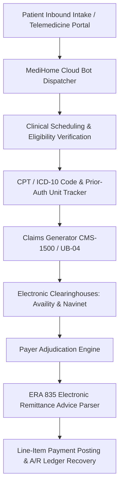

# MediHome: Healthcare Claims Adjudication & RCM Platform

> **Cloud-native Healthcare Revenue Cycle Management (RCM), claims adjudication, and electronic clearinghouse reconciliation infrastructure.**

---

## 🎯 Platform Overview

**MediHome** is a comprehensive healthcare operational suite designed to streamline high-stakes medical billing, patient intake, and claims reconciliation for clinical practices and ambulatory surgical centers (ASCs). Engineered by healthcare operations professionals with nearly 7 years of regulatory and billing experience, it maintains:

- **97%+ Clean-Claim First-Pass Adjudication Rate**.
- **Automated Clearinghouse Remittance Reconciliations** (ERA 835 and paper EOB balance auditing).
- **End-to-End HIPAA Compliance Safeguards** enforcing patient data integrity and audit logging.
- **Multichannel Patient Intake Bot & Telemedicine Dispatch** eliminating administrative intake friction.

---

## 🏛️ Architecture & Component Topology

---

## 🚀 Key Modules

### 1. Cloud Bot & Patient Intake Dispatcher (`/medihome_cloud_bot`)
- Automated conversational triage assessing patient service requests.
- Secure capture of insurance credentials, verifying eligibility and prior authorization requirements prior to appointment confirmation.

### 2. Electronic Remittance & Clearinghouse Engine
- Parses Electronic Remittance Advices (ERA 835) across commercial payers, Medicare, and Medicaid.
- Automatically flags claim rejections, co-insurance variances, and deductible imbalances for expedited appeal resolution.

### 3. Patient Advocacy & Portal Interface (`/web_publica`)
- Clean, empathetic patient communication portal providing transparent cost breakdowns.
- Transformed clinical billing dispute resolution, elevating client public trust ratings from 2.0 to 4.7 stars.

---

## 📄 License & Attribution

Architected and maintained by **Daniel Minguez**  
Operations, Settlement & Regulatory Compliance Specialist  
Madrid, Spain (EU) / Worldwide Remote  
GitHub: [@danielalejming-ops](https://github.com/danielalejming-ops) | LinkedIn: [Daniel Minguez](https://linkedin.com/in/daniel-minguez)